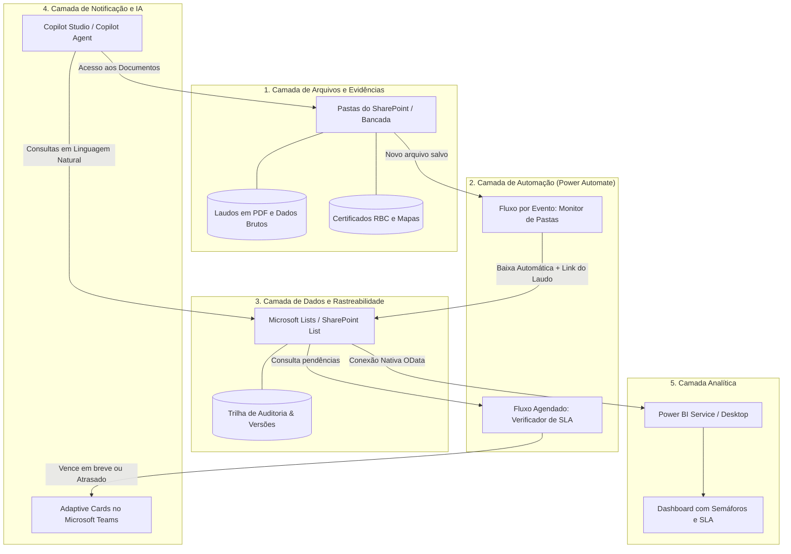

# LabQuality| Sistema de Gestão e Monitoramento de Controle de Qualidade Laboratorial

> **Projeto interdisciplinar integrando Biomedicina Diagnóstica e Sistemas de Informação.**  
> Uma solução corporativa baseada no ecossistema **Microsoft 365** (Power BI, Power Automate, Microsoft Lists e Copilot) para rastreabilidade de processos de qualidade, manutenção de equipamentos e conformidade com normas regulatórias (**RDC 786/2023 da Anvisa**, **PALC**, **DICQ** e **ISO 15189**).

---

## Sumário
1. [Contexto & Justificativa](#contexto--justificativa)
2. [Arquitetura da Solução](#arquitetura-da-solução)
3. [Modelo de Dados (Microsoft Lists)](#modelo-de-dados-microsoft-lists)
4. [Automação e Agente Copilot (Power Automate & Teams)](#automação-e-agente-copilot)
5. [Métricas e Inteligência Analítica (Power BI)](#métricas-e-inteligência-analítica-power-bi)
6. [Privacidade de Dados & LGPD (Privacy by Design)](#privacidade-de-dados--lgpd)
7. [Como Executar o Projeto Localmente](#como-executar-o-projeto)

---

## Contexto & Justificativa

Em um laboratório de análises clínicas, a garantia da qualidade analítica não depende apenas da perícia do profissional, mas do rigor na execução e registro de processos periódicos.

Frequentemente, esses controles são geridos através de cadernos de bancada, pranchetas ou planilhas despadronizadas, o que acarreta:
* **Falta de visibilidade temporal:** Dificuldade em antecipar manutenções semestrais ou calibrações anuais.
* **Sobrecarga operacional:** Risco de esquecimento durante picos de rotina na bancada.
* **Vulnerabilidade em auditorias:** Dificuldade em recuperar evidências de calibrações passadas e ações corretivas frente a desvios das regras de Westgard.

O **LabQuality** resolve esses desafios estruturando um fluxo digital integrado onde a tarefa é registrada, monitorada em tempo real e alertada proativamente via agente no Microsoft Teams.

---

## Arquitetura da Solução



---

## Modelo de Dados (Microsoft Lists)

A lista principal foi desenhada para atender aos requisitos de auditoria de acreditação laboratorial:

| Campo | Tipo | Descrição | Exemplo |
| :--- | :--- | :--- | :--- |
| `ID_Processo` | Texto (Chave) | Identificador único do procedimento | `CQ-001` |
| `Nome_Processo` | Texto | Nome descritivo da rotina | `Controle Interno Nível 1 e 2 - Analisador Bioquímico` |
| `Setor` | Escolha | Bancada ou área técnica | `Bioquímica`, `Hematologia`, `Imunologia`, `Geral` |
| `Periodicidade` | Escolha | Intervalo de repetição | `Diário`, `Semanal`, `Mensal`, `Semestral`, `Anual` |
| `Responsavel_Cargo` | Texto / Usuário | Responsável técnico pela execução | `Biomédico Rotina Bioquímica` |
| `Data_Prevista` | Data | Data limite calculada para conclusão (SLA) | `2026-11-18` |
| `Status` | Escolha | Situação operacional do controle | `Pendente`, `Em Progresso`, `Concluído`, `Atrasado` |
| `Data_Conclusao` | Data e Hora | Carimbo de data/hora do encerramento (capturado pelo arquivo) | `2026-11-18 07:45` |
| `Evidencia_Anexo` | Anexos / Link | PDF de laudo, certificado RBC ou link direto na pasta SharePoint | `Mapa_Levey_Jennings.pdf` |
| `Acao_Corretiva_Obs` | Texto Multilinha | Justificativa ou conduta frente a desvios | `Dentro da faixa aceitável (1s).` |

---

## Automação e Agente Copilot

### 1. Baixa Automática por Monitoramento de Pastas (Power Automate)
* **Gatilho:** Novo laudo ou arquivo de dados brutos adicionado à pasta da bancada no SharePoint.
* **Processamento:** O fluxo identifica o procedimento pendente, altera o status para `Concluído`, registra a data/hora oficial e vincula a evidência.
* **Benefício:** Zero esforço manual de digitação na bancada e conformidade auditável em tempo real.

### 2. Rotina Diária de SLA e Alertas no Microsoft Teams
1. **Gatilho:** Recorrência diária às 07:00 (horário de abertura do laboratório).
2. **Consulta OData na Lista:**
   ```text
   Status ne 'Concluído' and Data_Prevista le '@{addDays(utcNow(), 2, 'yyyy-MM-dd')}'
   ```
3. **Ação:** Envio de um **Adaptive Card** no canal do Microsoft Teams com alertas de pendências ou manutenções próximas ao vencimento.

### 3. Consultas com Copilot Agent
Integrado ao Microsoft 365, o agente permite perguntas como:
* *"Quais manutenções preventivas semestrais vencem neste mês?"*
* *"O controle de temperatura da geladeira de reagentes 01 já foi registrado hoje?"*

---

## Métricas e Inteligência Analítica (Power BI)

Fórmulas DAX utilizadas para compor os semáforos de conformidade:

### 1. Taxa de Conformidade no Prazo (%)
```dax
Taxa_Conformidade_Prazo = 
VAR TotalConcluidosNoPrazo = 
    CALCULATE(
        COUNTROWS(Controles),
        Controles[Status] = "Concluído",
        Controles[Data_Conclusao] <= Controles[Data_Prevista]
    )
VAR TotalGeral = COUNTROWS(Controles)
RETURN
    DIVIDE(TotalConcluidosNoPrazo, TotalGeral, 0)
```

### 2. Quantidade de Controles Críticos em Atraso
```dax
Qtd_Controles_Atrasados = 
CALCULATE(
    COUNTROWS(Controles),
    Controles[Status] = "Atrasado" || 
    (Controles[Status] <> "Concluído" && Controles[Data_Prevista] < TODAY())
)
```

---

## Privacidade de Dados & LGPD

> **Declaração de Conformidade Ética e de Privacidade:**  
> Este projeto foi desenvolvido para fins educacionais e de portfólio profissional.  
> * **Zero dados de pacientes:** O escopo do projeto limita-se ao controle metrológico de equipamentos e insumos diagnósticos.
> * **Dados Sintéticos:** Todos os dados, nomes e registros contidos nos arquivos de exemplo são completamente fictícios (*Privacy by Design*), respeitando a Lei Geral de Proteção de Dados (LGPD - Lei nº 13.709/2018) e o sigilo industrial e corporativo.

---

## Como Executar o Projeto

1. **Clonar o Repositório:**
   ```bash
   git clone https://github.com/SEU-USUARIO/Controle_qualidade.git
   cd Controle_qualidade
   ```
2. **Importar Dados de Teste:**
   * Acesse o Microsoft Lists ou SharePoint.
   * Selecione `Nova Lista` > `Do arquivo CSV` e aponte para `data/dados_sinteticos_cq.csv`.
3. **Conectar ao Power BI:**
   * Abra o Power BI Desktop > `Obter Dados` > `Lista do SharePoint Online`.
   * Insira a URL do seu site e carregue a tabela para visualizar o dashboard.

---

## Autora
**Biomédica & Graduanda em Sistemas de Informação**  
Unindo saúde diagnóstica, governança de dados e tecnologia.
